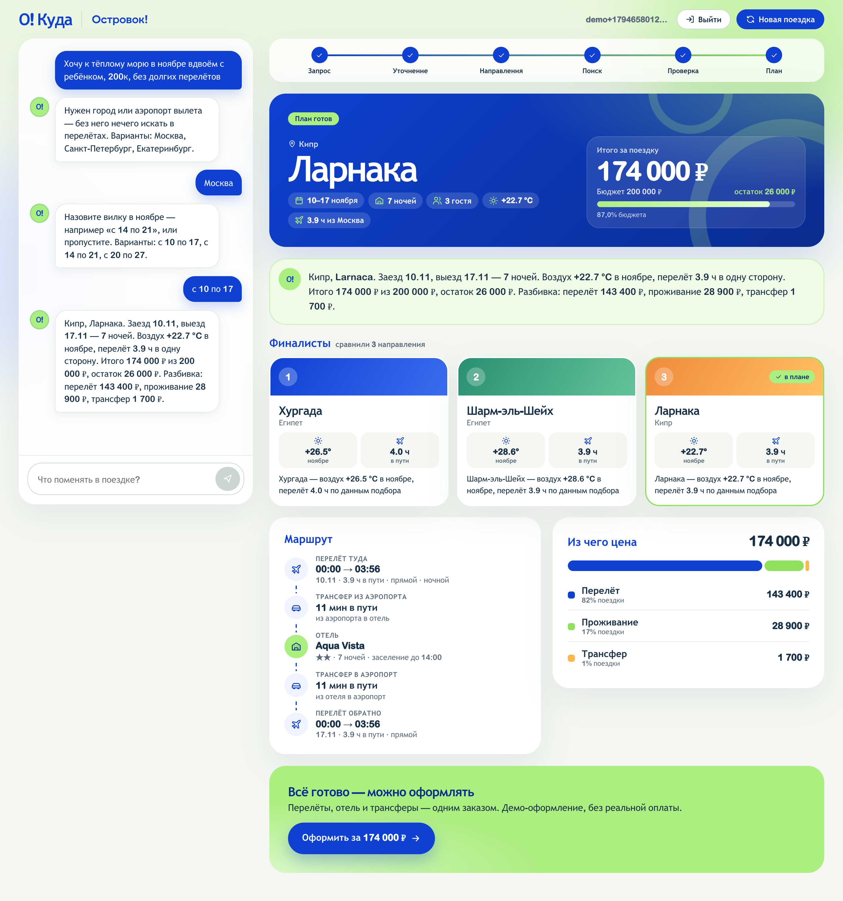
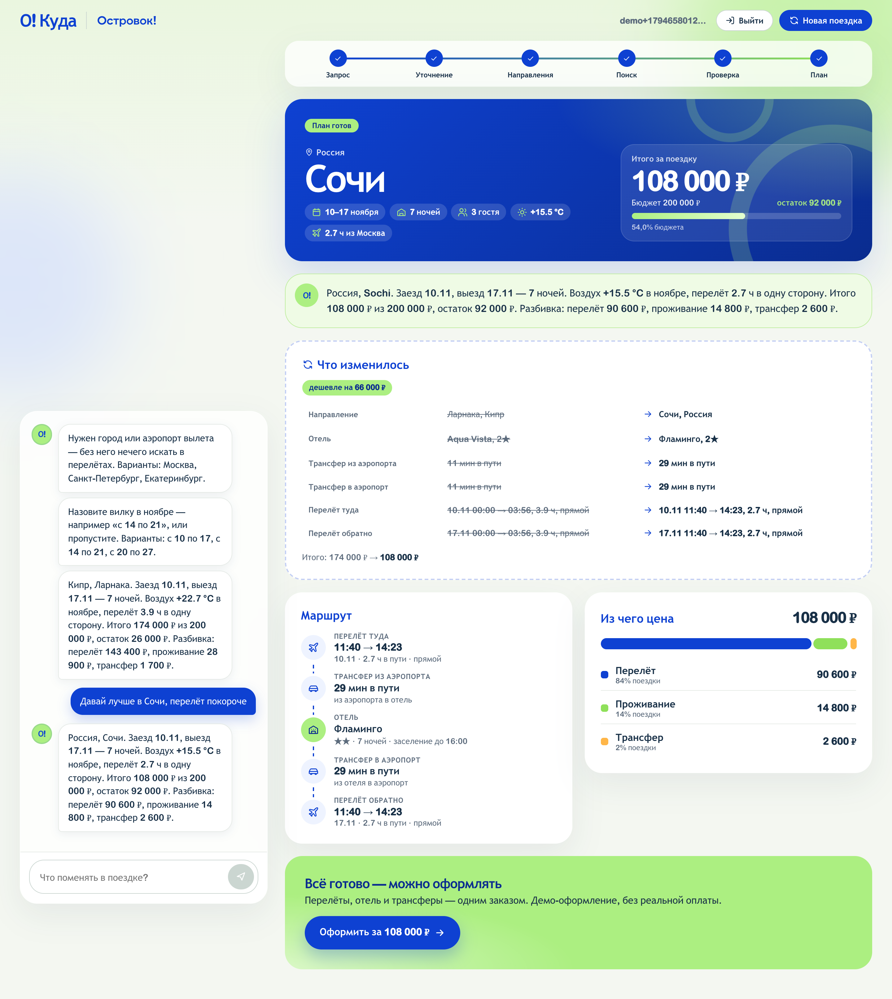
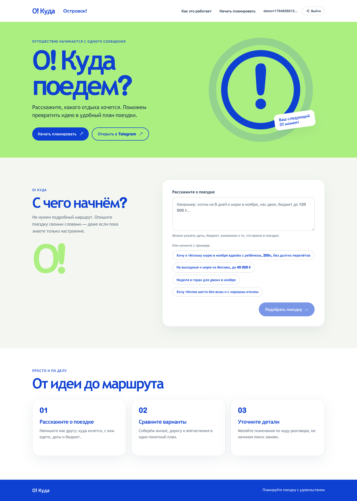
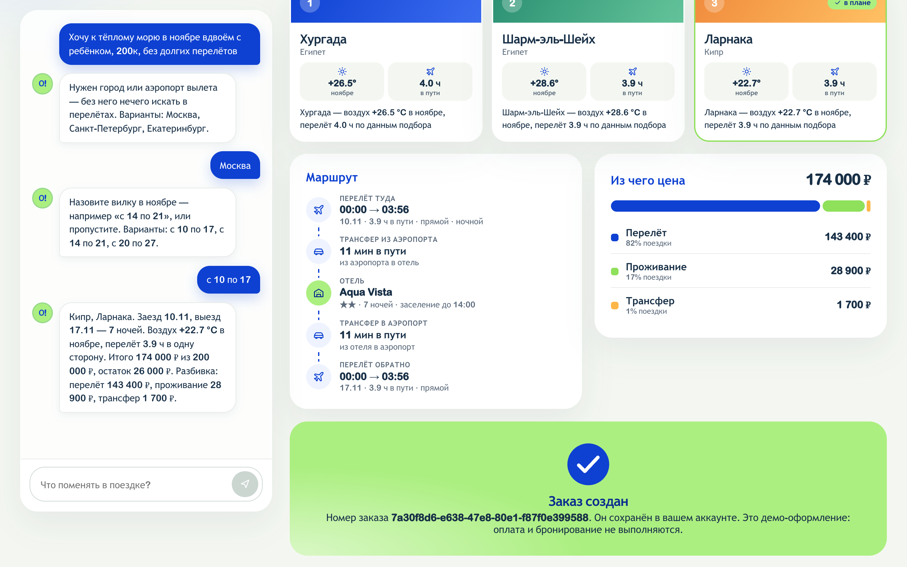

# AI Travel Agent

[](https://github.com/Powarar/AI-travel-agent/actions/workflows/ci.yml)

[Русская версия](README.ru.md) · [Architecture](docs/ARCHITECTURE.md) · [ADR](docs/adr.md) · [Evidence](docs/evidence/)

[Operations and deployment preparation](docs/operations.md) · [Local live monitoring](http://localhost:8080/monitoring.html)

For a server release with built frontend assets, private PostgreSQL and automatic TLS,
use [the deployment runbook](deploy/README.md) and `compose.production.yml`.

A trip-planning agent that turns a conversational request into a **traceable, constraint-aware
plan**. The model understands language and writes prose; code owns prices, availability,
validation and the final decision.

> **Status:** working prototype on a synthetic catalogue. Checkout is a mock. It is not a
> booking engine and must not be presented as one.

## The idea

Most LLM travel demos fail the same way: the model invents a price, drops a hard constraint,
or quietly forgets the hotel it picked two turns ago. This project makes those failures
less likely through explicit contracts and deterministic checks:

- **`TripState` is the only source of truth.** Chat produces a typed delta, never state.
- **Hard constraints are filtered in SQL.** Vector similarity ranks *inside* the admissible
  set and can never widen it.
- **Money is `Decimal`-only.** The type rejects binary floats; the frontend mirrors it with
  BigInt kopecks.
- **An honesty guard checks the answer against computed state** — both numbers and price
  claims. One regeneration, then a template built from state.
- **Incremental replanning.** "Make it three people" re-ranks; it does not re-search the weather.

## Architecture

```
browser / Telegram Mini App
            │
            ▼
   nginx :8080  ── per-IP rate limits, security headers, unbuffered SSE
            │
      ┌─────┴─────┐
      ▼           ▼
 backend :8000   web :5173
 FastAPI         React + TS
      │
      ├─ planning agent (in-process library, not a service)
      │
      ▼
 PostgreSQL 16 + pgvector
```

A modular monolith: the agent runs inside the backend process, boundaries are packages and
typed contracts. See [ADR-001](docs/adr.md) for why, and what would change that.

| Path | Responsibility |
| --- | --- |
| `web/` | React + TypeScript UI, Telegram Mini App |
| `services/backend/` | HTTP, auth, persistence, retrieval, ingestion, metrics |
| `services/agent/` | Planning graph, tool registry, validation, repair, LLM slots |
| `services/bot/` | Telegram adapter |
| `shared/contracts/` | Typed domain models |
| `data/` | Synthetic catalogue generators |
| `evaluation/` | Offline scenarios and grader |
| `tests/` | Unit, integration, agent, end-to-end |

## Measured, not claimed

Everything below is reproducible from a committed artifact or a command in this repo.

| What | Result | Source |
| --- | --- | --- |
| Test suite | **492 passed, 4 skipped** | `make test` |
| Skips | all 4 are live-LLM gated; **zero** DB skips | `pytest -rs` |
| Coverage | **87%** | `make coverage` |
| Types | mypy `--strict`, clean | `make lint` |
| Offline evaluation | **16 scenarios, all checks green** | `make eval` |
| Parse accuracy (live) | 37/37 required fields, 53/55 field checks, exact match 0.90 | [artifact](docs/evidence/parse-accuracy-2026-11-07-measured.json) |
| Cost of that run | **1.07814 ₽** for 20 cases | same artifact |
| Async end-to-end | 5/5 cases | [artifact](docs/evidence/async-e2e-2026-11-07.json) |

**Read the evidence honestly.** Two live runs were measured; a third failed with
`ConnectTimeout` on all 20 calls. The harness records that as
`accuracy_status=no_successful_model_samples` with `accuracy=null` — *not* as 0% accuracy,
because model quality is unknown when the model never answered. That run is committed too:
[connect-timeout](docs/evidence/parse-accuracy-2026-11-07-connect-timeout.json).
Exact match moved 0.95 → 0.90 between the two measured runs on the same dataset with
different prompt hashes. This does not isolate prompt effects from model variance;
two runs give no reliable confidence interval.

No load numbers exist. The stand was never load-tested, so there is no RPS or p95-under-load
figure anywhere in this repo.

## Quick start

Requires Docker Desktop with Compose. Python 3.11+ and Node 22+ only for running tests or
the frontend outside Docker.

```bash
cp .env.example .env
make setup      # Python env from requirements.lock
make up         # postgres + backend + web + nginx, migrations applied
make seed       # synthetic catalogue
make test
```

Open **http://localhost:8080** — nginx is the only published port; backend and web are bound
to loopback. Register an account, then describe a trip.

The default `LLM_PROVIDER=mock` is deterministic and needs no API key. For a real
OpenAI-compatible provider set `LLM_PROVIDER`, `LLM_API_KEY`, `LLM_BASE_URL` and the model
variables in `.env`. Never commit `.env`.

`AUTH_JWT_SECRET` signs access and refresh tokens. An empty value is acceptable only
locally: the backend generates a random per-process key, so sessions do not survive a
restart. `scripts/init_dev.sh` fills in a random key when it creates `.env`; in production
the key is set explicitly and kept out of the repository.

## Demo

`make demo-shots` drives a headless Chromium through the live stack over nginx and writes
real screenshots into `docs/img/`: registration, clarifying questions, the plan, checkout,
a reload that restores the session and the saved plan, and a replan with a price diff. The
same run injects a single 401 on `/orders` to prove the client silently refreshes the token
and retries; the step log, console errors and failed requests land in
`artifacts/demo-shots-report.json`, with a committed copy of the run in
`docs/evidence/demo-shots-2026-11-14.json`.

| Plan | Replan diff |
| --- | --- |
|  |  |
| **App landing** | **Order** |
|  |  |

## Commands

```bash
make setup      # create the Python development environment
make up         # start the stack and run migrations
make down       # stop the stack
make seed       # load the development catalogue
make test       # Python test suite
make coverage   # suite + coverage report
make lint       # ruff + mypy strict + architecture guardrails
make eval       # offline evaluation scenarios
make demo-shots # real browser screenshots of the live stack
make web        # frontend in Docker with hot reload
make lock       # regenerate requirements.lock
```

## Security posture

- **Auth:** email + password (argon2id) with JWT access (900 s) and rotating refresh (30 d)
  including reuse detection. Telegram `initData` HMAC is a second login path.
- **Ownership:** `trips.owner` is `NOT NULL` and checked on every trip endpoint. Someone
  else's trip returns **404, not 403**, so trip ids are not an existence oracle. The old
  client-chosen `X-Client-Id` is gone.
- **Edge:** per-IP `limit_req` zones split by endpoint cost — auth 5 r/s, planning 2 r/s,
  reads 20 r/s — plus a connection cap. 429 is JSON in FastAPI's error shape.
- **Concurrency:** a turn is two short transactions with the LLM call *between* them and a
  compare-and-swap write, so no row lock or pooled connection is held for 45 s.

Known trade-offs are listed in [docs/ARCHITECTURE.md](docs/ARCHITECTURE.md#известные-ограничения),
not hidden: IP limits punish NAT, JWT access cannot be revoked before it expires, the browser
refresh token lives in `localStorage`, and there is no TLS on the local stand.

## Development principles

1. `TripState` is the source of truth; chat history only produces requirement changes.
2. Hard constraints are never silently weakened — return alternatives or ask for an explicit
   trade-off.
3. `Decimal`-based money types, never floats.
4. Catalogue data and offers are separate concerns; provenance is preserved.
5. LLM calls stay behind the provider interface. Validation, totals, dates and facts stay
   deterministic.
6. A test that cannot fail is worse than no test. Evaluation asserts that an injected attack
   actually reached the model before it asserts that the answer is clean ([ADR-016](docs/adr.md)).

Implementation guidance for coding agents lives in [AGENTS.md](AGENTS.md).

## Repository hygiene

Generated dependencies, Python caches, build output, local evaluation output and developer
secrets are ignored. Recreate them with `npm ci`, `make setup` or the relevant generator.
Committed evidence under `docs/evidence/` and `docs/img/` is an explicit exception: raw run
artifacts and screenshots produced by `make demo-shots`, kept so the numbers and the demo
above can be checked.
