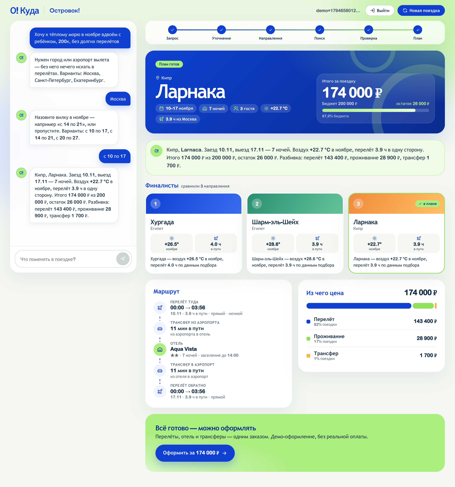
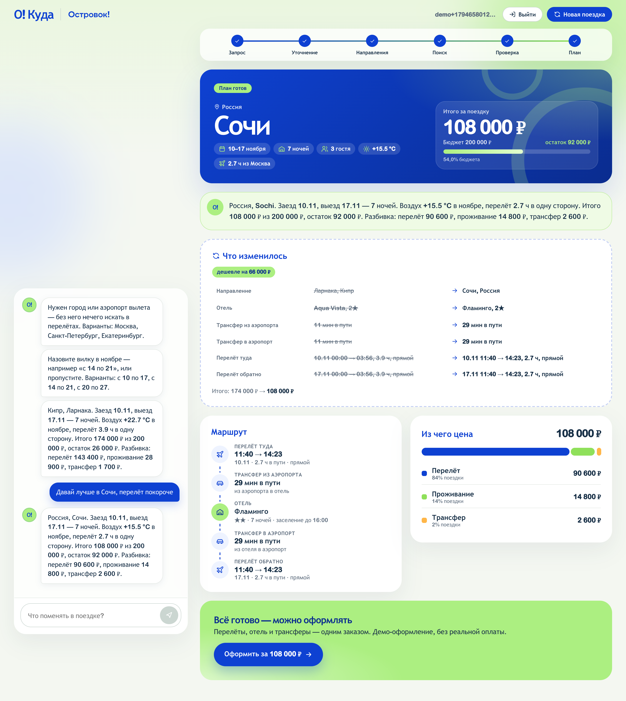
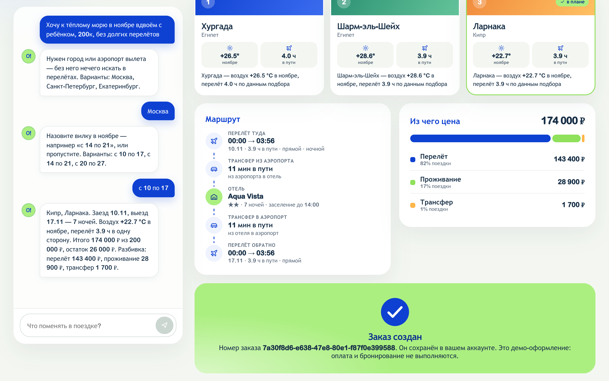

# AI Travel Agent

[](https://github.com/Powarar/AI-travel-agent/actions/workflows/ci.yml)

[English version](README.md) · [Архитектура](docs/ARCHITECTURE.md) · [ADR](docs/adr.md) · [Замеры](docs/evidence/)

Агент планирования поездок: превращает разговорный запрос в **проверяемый план с учётом
жёстких ограничений**. Модель понимает язык и пишет текст; цены, доступность, проверку и
итоговое решение считает код.

> **Статус:** рабочий прототип на синтетическом каталоге. Checkout — mock. Это не движок
> бронирования, и выдавать его за такой нельзя.

## Идея

Большинство LLM-демо про поездки ломаются одинаково: модель придумывает цену, теряет жёсткое
ограничение или тихо забывает отель, который сама выбрала два хода назад. Здесь такие отказы
сделаны структурно невозможными, а не «выправлены промптом»:

- **`TripState` — единственный источник истины.** Чат порождает типизированную дельту, а не состояние.
- **Жёсткие ограничения фильтруются в SQL.** Векторная близость ранжирует *внутри* допустимого
  множества и не может его расширить.
- **Деньги только на `Decimal`.** Тип отвергает бинарные float; фронт повторяет правило на
  BigInt-копейках.
- **Guard честности сверяет ответ с посчитанным состоянием** — и числа, и утверждения о цене.
  Одна перегенерация, затем шаблон из состояния.
- **Инкрементальная пересборка.** «Давай на троих» пере-ранжирует, а не ищет погоду заново.

## Архитектура

```
браузер / Telegram Mini App
            │
            ▼
   nginx :8080  ── лимиты по IP, security-заголовки, SSE без буферизации
            │
      ┌─────┴─────┐
      ▼           ▼
 backend :8000   web :5173
 FastAPI         React + TS
      │
      ├─ агент планирования (библиотека в том же процессе, не сервис)
      │
      ▼
 PostgreSQL 16 + pgvector
```

Модульный монолит: агент исполняется внутри процесса backend, границы — пакеты и типизированные
контракты. Почему так и что это изменит — [ADR-001](docs/adr.md).

| Путь | Ответственность |
| --- | --- |
| `web/` | React + TypeScript, Telegram Mini App |
| `services/backend/` | HTTP, аутентификация, персистентность, retrieval, загрузка, метрики |
| `services/agent/` | граф планирования, реестр инструментов, валидация, repair, слоты LLM |
| `services/bot/` | адаптер Telegram |
| `shared/contracts/` | типизированные модели предметной области |
| `data/` | генераторы синтетического каталога |
| `evaluation/` | офлайн-сценарии и грейдер |
| `tests/` | unit, integration, agent, сквозные |

## Замерено, а не обещано

Каждая строка воспроизводится из закоммиченного артефакта или команды в этом репозитории.

| Что | Результат | Источник |
| --- | --- | --- |
| Тесты | **492 пройдено, 4 пропущено** | `make test` |
| Пропуски | все 4 — гейт живого LLM; пропусков по БД **ноль** | `pytest -rs` |
| Покрытие | **87%** | `make coverage` |
| Типы | mypy `--strict`, чисто | `make lint` |
| Офлайн-evaluation | **16 сценариев, все проверки зелёные** | `make eval` |
| Точность разбора (живой прогон) | 37/37 обязательных полей, 53/55 проверок, exact match 0.90 | [артефакт](docs/evidence/parse-accuracy-2026-11-07-measured.json) |
| Стоимость того прогона | **1.07814 ₽** за 20 кейсов | тот же артефакт |
| Сквозной async-прогон | 5/5 кейсов | [артефакт](docs/evidence/async-e2e-2026-11-07.json) |

**Как читать замеры честно.** Два живых прогона измерены; третий упал с `ConnectTimeout` на
всех 20 вызовах. Харнесс записывает это как `accuracy_status=no_successful_model_samples` и
`accuracy=null` — **не** как «0% точности», потому что при молчащей модели её качество
неизвестно. Этот прогон тоже закоммичен:
[connect-timeout](docs/evidence/parse-accuracy-2026-11-07-connect-timeout.json).
Exact match сдвинулся 0.95 → 0.90 между двумя измеренными прогонами на одном датасете и одном
промпте: это разброс модели, и два прогона не дают доверительного интервала.

Нагрузочных цифр нет. Стенд не нагружался, поэтому в репозитории нет ни RPS, ни p95 под нагрузкой.

## Быстрый старт

Нужен Docker Desktop с Compose. Python 3.11+ и Node 22+ — только для тестов или фронта вне Docker.

```bash
cp .env.example .env
make setup      # Python-окружение из requirements.lock
make up         # postgres + backend + web + nginx, миграции применены
make seed       # синтетический каталог
make test
```

Открыть **http://localhost:8080** — nginx единственный опубликованный порт, backend и web
привязаны к loopback. Зарегистрироваться и описать поездку.

Дефолтный `LLM_PROVIDER=mock` детерминирован и не требует ключа. Для реального
OpenAI-совместимого провайдера задать `LLM_PROVIDER`, `LLM_API_KEY`, `LLM_BASE_URL` и модели
в `.env`. Никогда не коммитить `.env`.

`AUTH_JWT_SECRET` подписывает access- и refresh-токены. Пустое значение допустимо только
локально: backend генерирует случайный ключ на процесс, и сессии не переживают рестарт.
`scripts/init_dev.sh` подставляет случайный ключ при создании `.env`; в проде ключ задаётся
явно и хранится вне репозитория.

## Демо

`make demo-shots` проводит headless Chromium по живому стеку через nginx и кладёт настоящие
скриншоты в `docs/img/`: регистрация, уточняющие вопросы, план, оформление, перезагрузка,
восстанавливающая сессию и сохранённый план, и перепланирование с диффом цены. Тот же
прогон подставляет один искусственный 401 на `/orders`, чтобы доказать: клиент молча
обновляет токен и повторяет запрос. Лог шагов, ошибки консоли и упавшие запросы — в
`artifacts/demo-shots-report.json`; зафиксированная копия прогона —
`docs/evidence/demo-shots-2026-11-14.json`.

| План | Дифф перепланирования |
| --- | --- |
|  |  |
| **Лендинг приложения** | **Заказ** |
|  |  |

## Команды

```bash
make setup      # создать Python-окружение
make up         # поднять стек и применить миграции
make down       # остановить стек
make seed       # загрузить каталог разработки
make test       # тесты Python
make coverage   # тесты + отчёт покрытия
make lint       # ruff + mypy strict + архитектурные проверки
make eval       # офлайн-сценарии evaluation
make demo-shots # настоящие скриншоты живого стека в браузере
make web        # фронт в Docker с hot reload
make lock       # пересобрать requirements.lock
```

## Безопасность

- **Аутентификация:** email + пароль (argon2id), JWT access (900 с) и ротируемый refresh
  (30 дней) с детектом повторного использования. Telegram `initData` HMAC — второй путь входа.
- **Владение:** `trips.owner` `NOT NULL`, проверяется на каждом эндпоинте поездки. Чужая
  поездка отвечает **404, а не 403**, поэтому id не работает как оракул существования.
  Прежний `X-Client-Id`, который клиент выбирал сам, удалён.
- **Граница:** зоны `limit_req` по IP разделены по стоимости эндпоинта — auth 5 r/s,
  планирование 2 r/s, чтения 20 r/s — плюс лимит соединений. 429 отдаётся JSON в формате
  ошибок FastAPI.
- **Конкурентность:** ход — две короткие транзакции, LLM-вызов *между* ними, запись через
  compare-and-swap. Ни блокировки строки, ни соединения из пула на 45 с.

Известные компромиссы перечислены в
[docs/ARCHITECTURE.md](docs/ARCHITECTURE.md#известные-ограничения), а не спрятаны: лимиты по IP
наказывают NAT, JWT access нельзя отозвать до истечения, refresh в браузере лежит в
`localStorage`, TLS на локальном стенде нет.

## Принципы разработки

1. `TripState` — источник истины; история чата порождает только изменение требований.
2. Жёсткие ограничения не ослабляются молча — альтернативы или явный запрос на компромисс.
3. Деньги на `Decimal`, никогда на float.
4. Данные каталога и офферы — разные сущности; provenance сохраняется.
5. Вызовы LLM за интерфейсом провайдера. Валидация, итоги, даты и факты детерминированы.
6. Тест, который не может упасть, хуже отсутствующего. Evaluation сначала требует, чтобы
   внедрённая атака действительно дошла до модели, и только потом — что ответ чистый
   ([ADR-016](docs/adr.md)).

Правила для кодирующих агентов — в [AGENTS.md](AGENTS.md).

## Гигиена репозитория

Сгенерированные зависимости, кеши Python, сборка, локальные выводы evaluation и секреты
игнорируются. Восстанавливаются через `npm ci`, `make setup` или генератор. Закоммиченные
замеры в `docs/evidence/` и скриншоты в `docs/img/` — явное исключение: сырые артефакты
прогонов и снимки `make demo-shots`, чтобы числа и демо выше можно было проверить.