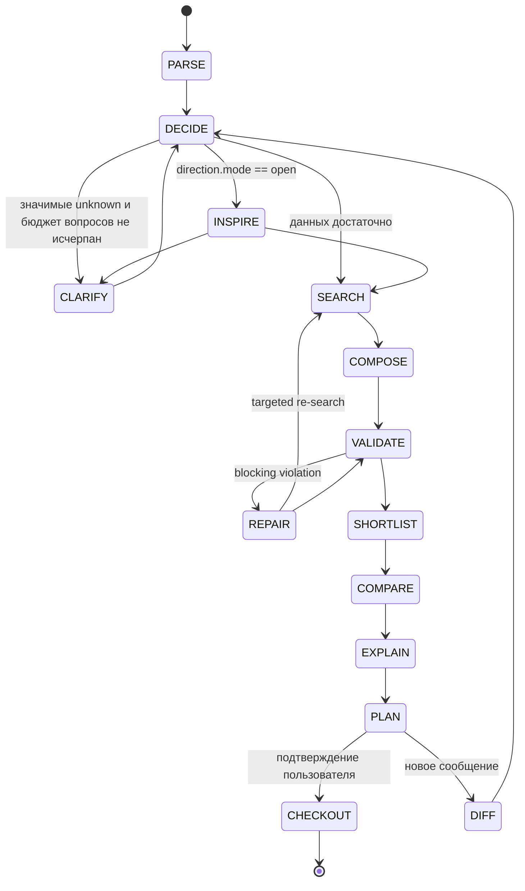
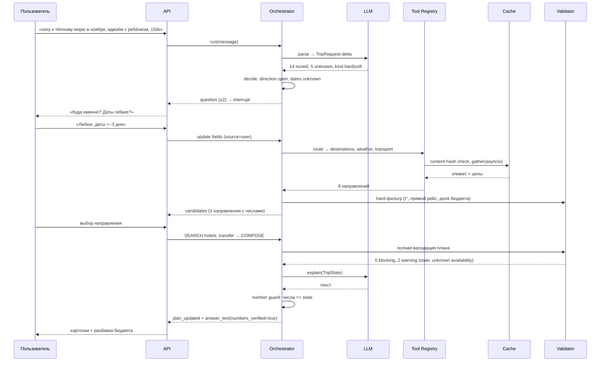
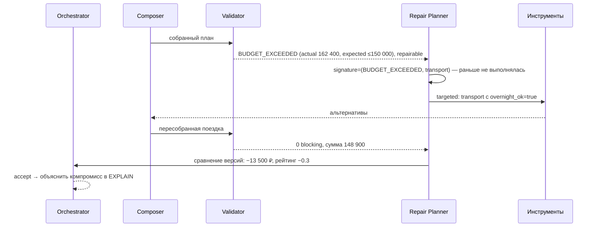
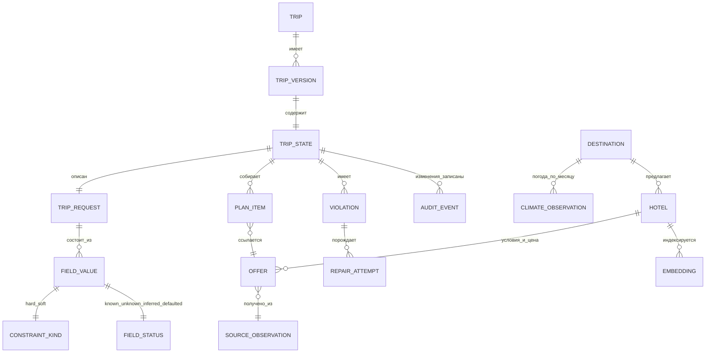

# Архитектура агента

Один FastAPI-процесс, внутри — компоненты с явными контрактами. Ниже: что за что
отвечает, почему граница проведена именно там, и как это выглядит в рантайме.

## 0. Три инварианта, из которых всё остальное следует

Осознанно принятые ограничения. Любое изменение в архитектуре обязано их не нарушить:

1. **`TripState` — единственный источник истины.** История чата только порождает delta
   требований; состояние поездки живёт в типизированном объекте с версиями.
2. **Hard-constraint не ослабляется молча.** Ни ранжированием, ни repair, ни «модель
   решила, что так будет лучше».
3. **Модель не считает и не утверждает факты.** Цены, суммы, даты, стыковки, статусы
   доступности приходят из кода и из источников с provenance.

Из (1) следует инкрементальная пересборка и replay. Из (2) — что валидатор должен быть
кодом. Из (3) — number guard на выходе.

## 1. Слои и компоненты

```
API (v1, версионируемый, идемпотентный)
 ├─ Orchestrator — граф-рантайм: узлы state→state, рёбра policy, checkpoint, interrupt
 ├─ DecisionProvider — интерфейс решений: спросить/Proceed, soft-релевантность, gate
 ├─ LLM-адаптеры — 6 слотов с типизированным вводом-выводом (см. LLM-BOUNDARY.md)
 ├─ Tool Registry — декларация инструментов: inputs, guard, cost, retries, cache
 ├─ Retrieval — SQL hard-фильтр → векторный скор внутри отфильтрованного
 ├─ Ranking — объяснимая взвешенная формула на нормализованных признаках
 ├─ Trip Composer — склейка транспорт/ночи/трансфер/активности + корзина
 ├─ Validator — детерминированные проверки → структурированные violations
 ├─ Repair Planner — маппинг violation→действие, дедуп подписей, лимит итераций
 ├─ Conversation Manager — сообщения и их связь с trip_id (не состояние!)
 ├─ Cache — content-hash аргументов инструмента; в демо-пути внешних вызовов нет
 ├─ Source Adapters — единый интерфейс: catalog / weather / transport / mock
 ├─ Observability — run_id, фазы, вызовы, токены, стоимость → replay
 └─ Evaluation — сценарии + детерминированные грейдеры + метрики
```

**Почему монолит:** границы между компонентами — типы и контракты, они и есть граница
ответственности. Сетевые границы на 3.5 дня и одного автора агентской части дали бы только
расходы на отладку транспорта.

**Почему orchestrator отдель от DecisionProvider:** это единственное место, где
допустима подмена «детерминированный порог ↔ модель решений». Решения с вероятностью
не должны протекать в маршрутизацию инструментов (см. §4).

## 2. Фазы



INSPIRE запускается **только** при `direction.mode == open`. На «хочу в Италию» фаза
не выполняется: направление не ищется, если его просили задать.

`CLARIFY` — это `interrupt` рантайма, а не отдельный сервис: пауза на ответе
пользователя уже встроена в границу HTTP-запроса, поэтому human-in-the-loop не стоит
никаких фреймворков.

## 3. Контур одного хода

```
сообщение
 → PARSE      LLM: TripRequest-delta (значение + kind + status + source + confidence)
 → DECIDE     какие unknown значимы → ASK | SEARCH | ESCALATE
 → ROUTE      affected-поля → реверс-индекс реестра → минимальный набор инструментов
 → RUN        asyncio.gather, ≤12 вызовов, кэш по content-hash
 → FILTER     SQL: hard (даты, гости, бюджет/ночь, pet_friendly, amenities)
 → VECTOR     embed(pref_text) → скор внутри SQL-множества
 → RANK       Σ весов: cost, vec, coherence, quality, data_confidence
 → COMPOSE    совместимые комбинации → корзина
 → VALIDATE   бюджет · temporal · стыковки · целостность данных · provenance
 → REPAIR     ≤2 итерации, только затронутые компоненты
 → EXPLAIN    LLM: текст по структурированным данным
 → GUARD      числа ответа == TripState
 → EMIT       SSE-события + TripState(version+1)
```

Лимиты контура: ≤6 LLM-вызовов, ≤12 tool-вызовов, ≤20 с wall-clock, ≤2 вопроса, ≤2
repair-итерации. По исчерпании выдаётся не ошибка, а «лучший допустимый вариант + список
неподтверждённого».

## 4. Граф зависимостей — ядро инкрементальности

Граф здесь — это не flow-chart, а карта `поле → инструмент` с обратным индексом.

```python
Tool(
  name="hotel_search",
  inputs={"destination", "dates.start", "dates.end", "party.adults", "party.children",
          "party.pets", "lodging.budget_per_night_max", "lodging.must", "soft_preferences"},
  guard=lambda s: s.destination_resolved,     # Callable, не выражение в DSL
  cost="high", retries=3, backoff=(0.5, 1.0, 2.0), timeout=3.0,
  breaker=(failures=3, window=60), fallback="stale_cache",
)

def affected(changed: set[str]) -> set[str]:
    dirty = {t.name for t in TOOLS if changed & t.inputs}
    return dirty | downstream(dirty)          # COMPOSE и VALIDATE всегда downstream
```

Почему не JEXL/CEL/JSON-Logic: условие `guard` — это Python-лямбда над типизированным
state. Свой язык выражений за эти сроки стоит дороже, чем весь выигрыш от декларативности,
и лишает меня типов и тестов.

### Ступени эскалации дельты

Порядок обязательный — от самого дешёвого к дорогому:

| Ступень | Что делаем | Вызовов | Триггер перехода дальше |
|---|---|---|---|
| 0 | пере-ранжировать уже найденных кандидатов | 0 | candidate-множество не изменилось по hard-фильтру |
| 1 | пересчитать **выбранный** план на новых входных | 0–1 | выбранный компонент нарушает ограничение |
| 2 | re-search только грязных инструментов | 2–3 | в допустимом множестве пусто |
| 3 | расширить поиск (другие даты/направление) | 5+ | только с разрешения, если задевает hard |

Работа на двух реальных дельтах:

**«у нас ещё собака»** → `party.pets: false→true`. Ступень 1: pet_friendly у выбранного
отеля и правила перевозки. Не прошло → ступень 2: `hotels`, `transport`, `transfer`.
`destinations` и `weather` не дёргаются — они не подписаны на `pets`.

**«давай на троих, условия те же»** → `party.size: 2→3`. Ступень 1: влезает ли тройка в
выбранный номер (может, family room — тогда меняется только цена и пересобирается корзина,
поиск не запускается). Грязные: `transport`, `transfer`. `destinations`, `weather`, чаще
всего и `hotels` — нет.

**«бюджет на 30% меньше»** → ступень 0: источники не переспрашиваются вовсе, меняются
штраф за превышение и веса. Валидатор скажет `BUDGET_EXCEEDED` и кандидатов в бюджете в
памяти не останется — тогда ступень 2 на `hotel_search` с новым фильтром.

### Что граф даёт как проверяемое свойство

Не «мы используем граф», а два утверждения, которые тестируются:

1. **Корректность инвалидации:** измени `X` → пересчитались ровно `A, B, D`. Ложная
   инвалидация = лишние вызовы и потерянные выборы; пропущенная = невалидный план.
2. **Экономия:** первичный запрос — N вызовов, дельта — M вызовов. Это число идёт в
   README и в питч.

## 5. Retrieval: гибрит без фьюжна

```
TripRequest ──→ SQL hard-фильтр ──→ допустимое множество ──→ ранжирование
     └→ pref_text (строит КОД) → embed → сходство ────────────────┘
```

Два правила, каждое с причиной:

- **Вектор ранжирует внутри SQL-множества и никогда его не расширяет.** Иначе semantic
  search приведёт отель с неподходящими датами только потому, что он «очень атмосферный».
- **Запрос к эмбеддингам собирает код:** `" ".join(soft values)`, тем же способом, чем
  индексировался отель (одна строка на объект: описание + район + удобства + теги + топ
  отзывов, без чанков). Просить модель писать поисковый запрос — значит добавить латентность
  и источник неверифицируемых изменений.

RRF/гибридный fusion-слой отложен не потому, что он плох, а потому что на ~400 объектах
его надо мерить. Как только появится бенчмарк «SQL-only vs гибрит» с разницей, оправдывающей
сложность, — он добавляется одним компонентом, не переписыванием.

## 6. Composer и Validator

**Composer** решает не «лучший отель + лучший перелёт», а совместимую комбинацию:
прибытие ≤ дедлайна check-in, checkout ≤ отправления, трансферный буфер, ночи == даты,
вместимость, раздельный учёт scope бюджета (`total | per_person`, включает ли транспорт).
Начинается с ограниченного набора кандидатов и программной сборки; solver (OR-Tools) не
взят, потому что на 8–12 кандидатах на компонент перебор остаётся читаемым и предсказуемым
по времени.

**Validator** возвращает только структуру, никаких оценок в тексте:

```python
Violation(code, severity: blocking|warning|suggestion, affected_component,
          expected, actual, evidence, repairable, suggested_actions)
```

Пять групп проверок: hard-ограничения · temporal-стыковки · финансовая согласованность
(сумма, валюта, двойной учёт) · целостность данных (источник, дата проверки, availability,
synthetic) · качество (соответствие мягким предпочтениям).

`severity` принципиален: качественная оценка не может отменить blocking-нарушение, а
`warning` не может бытьPresentation-статусом «подтверждено».

**Почему валидатор — код, а не review-модель:** превышение бюджета на 8% — формальный
факт, и модель с вероятностью подтвердит «всё в порядке». Это единственный класс ошибок,
который на защите выглядит фатально.

## 7. Repair

```
Violation → классификация → затронутые компоненты → допустимые действия (маппинг кода)
→ выбор с учётом жёсткости и важности → targeted retrieval (только dirty)
→ пересборка → ПОВТОРНАЯ ПОЛНАЯ валидация → сравнение версий → принять | ещё | стоп
```

Три механизма, которые отличают это от «повторить запрос»:

- **Дедуп по подписи действия** `(violation_code, component, params_hash)` — повтор того же
  сам собой отбрасывается, цикл не буксует.
- **Лимит попыток и бюджета** — остановка по критерию качества, по исчерпанию или по
  отсутствию допустимых решений; во всех трёх случаях результат выдаётся с объяснением.
- **Полная повторная валидация** — локальная замена может сломать стыковку в другой части
  поездки; инкрементальный поиск не отменяет глобальную проверку.

## 8. Состояние и версии

```
trips(1) ─< trip_versions(N) ── 1:1 state_jsonb
state: request | stage | candidates | chosen | violations | repair_log
     | questions_asked | budgets | provenance
```

`version` растёт на каждый ход, предыдущие не мутируются. Отсюда берутся: «покажи, что
изменилось», «верни как было», replay прогона, аудит критических изменений и — главное для
UX — сохранение `chosen` при пересборке: замена отеля не сбрасывает выбранный перелёт.

## 9. Данные и происхождение

```
SourceAdapter.fetch(query) → Observation(payload, source_id, fetched_at, ttl, status)
  → normalize → schema-validate → dedup(content-hash) → entity + offer → index-text
  → embedding (если text изменился) → provenance
```

Разделение обязательное: **`Hotel`** (объект каталога: характеристики) и
**`HotelOffer`** (конкретное предложение: цена, условия, даты, availability, источник).
Характеристики объекта не хранятся в условиях предложения.

Статусы данных, которые видит пользователь: `verified | partially_verified | stale |
unknown | synthetic`. `unknown availability` не становится подтверждённым по умолчанию,
синтетическая цена не подаётся как рыночная. Это ровно то, что требует задание: моковые
данные допустимы, ложная маркировка — нет.

### Календарь ставок, а не «цена отеля»

Пока цены хранятся одной строкой на `offer`, запрос «а если на два дня позже» физически
непересчитываем: придётся идти в поиск заново, и ступень 1 для дат не работает. Поэтому
каталог и датозависимые части разделены:

```
hotels, activities, destinations          -- характеристики, без дат
stay_rates(hotel_id, date, price_per_night, availability, min_nights, source_id)
transport_legs(date, route, dep_at, arr_at, direct, duration, base_price, source_id)
transfers(destination_code, ...)          -- без дат, но с pet_ok и вместимостью
```

Сборка плана = сумма ставок за конкретные ночи + legs на конкретных датах + fee-строки.
Следствия, которые надо принять сейчас, а не чинить 28-го:

- **Воспроизводимость:** синтетика генерится детерминированно по seed, окно — даты демо
  ±14 дней, сезонный коэффициент по месяцу. Один и тот же «−30% бюджета» даёт один и тот же
  результат во всех eval-прогонах.
- **Пересчёт без поиска:** сдвиг дат на 2 дня = арифметика по уже загруженным `stay_rates`
  и `transport_legs`, 0 обращений к источникам. Это и есть ступень 1 на практике.
- **Отсутствие ставки — это статус, а не ноль:** нет строки на ночь →
  `UNKNOWN_AVAILABILITY` (warning) или `CANDIDATES_EMPTY` (blocking), но не средняя цена.
- **Деньги типизированы:** `Money(Decimal, currency)` + `PriceLine` + `BudgetLedger`,
  сборы отдельными строками, округление один раз в итоге. Иначе сумма в объяснении разойдётся
  с суммой в state, и number guard это поймает, но поздно.

Объём: 10 направлений × 40 отелей × 30 ночей ≈ 12 000 строк `stay_rates` — это ничего,
генерится за секунды и целиком лежит в локальной базе.


В демо-пути внешних вызовов нет: всё подогревается в локальную базу, а кэш по
content-hash аргументов делает повторные запросы бесплатными.

## 10. Контракт с фронтом

Фронту отдаётся `TripState` + поток событий, а не текст:

```
run_started · phase_changed · tool_started/completed/failed · question(interrupt)
· candidates(+ranking_factors) · violation · repair_started · plan_updated
(+changed_components, kept_components) · answer_text(numbers_verified)
· checkout_completed(simulated=true) · budget_exhausted
```

Причина: если UI рендерит строку модели, то при пересборке он теряет выбор пользователя и
не может показать «подтверждено / требует решения / не подтверждено». Текст — подпись к
событию, не носитель состояния.

## 11. Надёжность

Политика отказа живёт **на узле**, а не в глобальном декораторе: у погоды TTL неделя и
падение нестрашно, у транспорта высокая цена и он ломает весь план.

```
schema-failure  → Instructor-ретрай с обратной связью → fallback-парсер → FABRICATED_FIELD
transport-fail  → retries=3, backoff+jitter, timeout, только для GET
source-down     → circuit breaker → stale из кэша + флаг stale (warning, не блокировка)
semantic-fail   → violation → repair (≤2)
budget          → лимиты хода → «лучшее из найденного + что не подтверждено»
```

Checkout идемпотентен по `Idempotency-Key` — повтор не создаёт второй заказ. Внешний текст
(описания отелей, страницы) считается недоверенным и не может переопределить правила:
инструментам выдаются полномочия ровно в объёме их задачи.

## 12. Наблюдаемость и evaluation

**Трейс** одного прогона: `run_id` → фазы, входы/выходы инструментов, коды нарушений,
итерации repair, токены и стоимость. Это даёт и ответ на вопрос жюри «почему именно этот
вариант», и `make replay RUN=…` — офлайн-сборку того же плана из кэша.

**Грейдеры eval-набора** разделены принципиально: детерминированные (доля соблюдения
hard, корректность стыковок, fabricated-поля, доведён ли сценарий) и модельные — только там,
где без них нельзя (качество объяснения). Метрики: доля доведённых до плана, среднее число
уточнений, время до первой рекомендации, число ошибок стыковок,Repair success rate,
доля неподтверждённых утверждений. CI-гейт: падение доли соблюдения hard-ограничений
блокирует merge.

## 13. Рантайм-диаграммы

### Основной сценарий



### Дельта-пересборка

```mermaid
sequenceDiagram
    participant U as Пользователь
    participant O as Orchestrator
    participant M as LLM
    participant G as Граф зависимостей
    participant C as Cache
    participant R as Инструменты
    participant V as Validator

    U->>O: «у нас ещё собака»
    O->>M: diff → changed = {party.pets}
    O->>G: affected(pets) → transport, hotels, transfer + downstream
    G-->>O: dirty set; destinations, weather не тронуты
    O->>V: ступень 1: pet_friendly у выбранного отеля
    V-->>O: PET_NOT_ALLOWED (blocking)
    O->>R: ступень 2: re-search только dirty
    R->>C: weather/destinations не запрашивались вовсе
    C-->>R: hit по content-hash для перелёта
    R-->>O: новые кандидаты отелей
    O->>V: полная повторная валидация всей поездки
    V-->>O: 0 blocking
    O-->>U: plan_updated: changed=[hotel], kept=[transport, dates, transfer]
```

### Repair



### Доменная модель



`OFFER` отдельно от `HOTEL` принципиально: характеристики объекта и условия конкретного
предложения живут в разных сущностях, иначе цена с датой проверки прилипнет к каталогу.

## 14. Что здесь сознательно нет

Legal & Travel Compliance Layer сверх бинарного `visa_required_for` у направления;
solver; мультиагенты; RAG как отдельный агент; Quality Gate как сервис; память между
сессиями; post-purchase-сервисы; микросервисы. Ни один из шести пунктов задания этого не
требует, а визовые рекомендации без официальных источников означали бы гарантированно
правдивую ложь — что прямо противоречит инварианту №3.

## 15. Объём: ядро против полного контура

Этот документ описывает систему примерно на 2.5 недели работы одного человека, а в
распоряжении — 3.5 дня до сборки. Расхождение надо держать в явном виде, иначе оно
всплывет 28-го вечером в виде «дописываем на коленке».

**Ядро — то, без чего агент не соответствует заданиям 1–6:**

1. `TripRequest`/`TripState` + hard/soft-политика и разрешение противоречий.
2. Parse → Decide → Route → Run → Filter → Rank → Compose → Validate → Explain.
3. Календарь ставок (`stay_rates`, `transport_legs`) — иначе нет пересчёта по датам.
4. Валидатор стыковок и `BudgetLedger`.
5. Ступени 0/1/2 + два замеренных кейса дельты.
6. Question-as-interrupt, resume идемпотентный.
7. Number guard, лимиты хода, терминальные исходы (`best_effort`, `infeasible`).
8. Трейс `run_id` + eval на 12 сценариях с детерминированными грейдером.

**Полный контур — описано, но не строится сейчас (и это решение, а не задолженность):**
ступень 3 с разрешением, `AskAfterSweepProvider` и съёмные бэкенды решений, cross-encoder,
перенос узлов на `StateGraph`, circuit breaker по каждому источнику как отдельный механизм
(пока достаточно `fallback=stale` + флага), chaos-тест, replay из трейса, RRF-фьюжн,
property-тесты на hypothesis, память между сессиями, пост-покупка, идемпотентность
платежей как контракт (у нас mock).

Правило перехода: пункт из «полного контура» берётся в работу **только** когда ядро зелёное
и гейт дня пройден. Порядок сборки и гейты — в `docs/PLAN.md`.

Обоснование каждого решения, альтернативы и условия пересмотра — в `docs/adr.md`.
Схемы полей, коды нарушений и события — в `agent/CONTRACTS.md`.
Граница «модель / код» — в `docs/LLM-BOUNDARY.md`.
