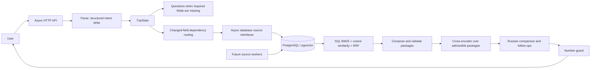

# Async planning and database retrieval

The HTTP path is now an awaited agent cycle inside the backend. It does not use a
global planner lock or `asyncio.to_thread` to hide synchronous model requests.
The synchronous `Runtime` facade and synchronous provider remain for offline CLI
compatibility; they are not wired into the default HTTP executor.



## Responsibilities

- `AsyncRuntime` owns orchestration, limits, selective service calls and state.
- `AsyncSlots` uses `httpx.AsyncClient` for Parse, Questions, Explain, Diff and rerank.
- `DatabaseSources` reads service-specific tables in consistent read snapshots.
  The existing pure offer converters consume a task-local snapshot. No seed files
  are read in the default HTTP path. Database records currently originate from the
  synthetic development catalogue, not live supplier inventory.
- The database serializes changes only for the same trip. Independent trips can
  await model requests concurrently. Completed runs retain their collected facts
  for selective replanning after process restarts.
- `TripState.options` holds up to three validated alternatives separately from
  `chosen`. They are displayed as comparisons. Direct atomic selection of an
  alternative by an option ID is not implemented in this patch.

## Retrieval

`search_documents` stores one document per hotel/model, content hash, Russian
lexeme term frequencies and `vector(1024)`. It has a cosine HNSW index. The
descriptive text contains known catalogue attributes and a source description
when present. Synthetic hotels do not acquire invented descriptions.

BM25 is computed in PostgreSQL with `k1=1.2` and `b=0.75`. Document frequencies
are taken over the indexed model's corpus. BM25 and cosine scoring return only
admissible hotel IDs. A zero lexical match does not enter the lexical ranking.

The fusion formula is:

```
score = 0.5 / (60 + lexical_rank) + 0.5 / (60 + semantic_rank)
```

Each term exists only when the document occurs in that lane. A ranking score is
not a probability or proof that a hard constraint is satisfied. Hotel availability
is checked before retrieval; complete packages are checked before rerank.

Query vectors are cached by model and SHA-256 hash for a day. Raw query text is
not stored in this cache. Embedding failure is explicitly reported as
`lexical_only:embedding_provider_error`; a hashing vector is never substituted
for the configured semantic model.

The package reranker sees at most twelve packages and may reorder them. It cannot
make an unavailable room, over-budget package or incompatible transfer admissible.
The original valid composition is always retained in the candidate pool.

## Models

| Role | Model |
| --- | --- |
| Parse / Questions / Diff | deepseek-v4.1-flash-1017 |
| Embeddings | qwen3-embedding-8b, dimensions=1024 |
| Package rerank | qwen3-reranker-8b |
| Rerank fallback | rerank-3-lite |
| Explain / follow-ups | qwen3.7-plus, temperature=0.2 |

Early generative city shortlisting is not used in this HTTP path. The admissible
destination recall set is retained until package costs can be checked.

## Operations and verification

```
make up
make seed                 # development catalogue only; truncates catalogue tables
make index-search         # paid embeddings only for changed descriptions
make test
make lint
RUN_LIVE_EVALS=1 make eval-async-live
```

Never run `make seed` against a supplier-populated production database. New
supplier workers must upsert normalized entities and offers with provenance in
their own transactions. They can call the indexer after changed descriptions;
price-only updates do not require new document embeddings. Supplier parsers and
their periodic scheduler are a subsequent implementation step.

The HTTP wall-clock budget is configurable through `AGENT_WALL_CLOCK_LIMIT_MS`
(45 seconds by default). The offline facade keeps its existing 20-second limit.
Embedding requests time out independently; operational degradation remains visible.

Per-model spans record model, slot, prompt version, latency, available token counts,
transport/schema errors and fallback. Spans are persisted in run events.
`GET /v1/monitoring/models` aggregates these events across backend restarts.
Null token counts mean the gateway did not report that breakdown.

The legacy summary's quality fields are now null until a real evaluation result is
provided. Quality metrics are not hardcoded to 100%. The live acceptance runner
stores measured results under ignored `artifacts/` and archives previous reports.
It separates functional behavior from provider reliability. Small live samples do
not establish parse accuracy, retrieval nDCG or production p95 latency.
