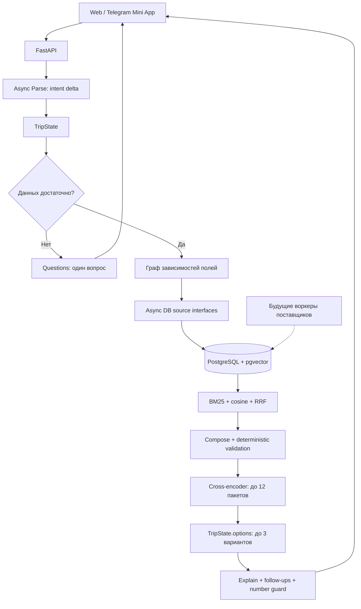

# AI Travel Agent: технический разбор для собеседования

Состояние проверено 6 ноября 2026 года. Это описание реализованного кода, а не
обещание, что все перечисленные компоненты готовы к промышленной эксплуатации.

## 1. Как представить проект за минуту

«Я разрабатываю travel-планировщик с диалоговым интерфейсом. LLM извлекает намерение
пользователя в типизированное состояние, а код ищет и собирает совместимые пакеты
из транспорта, проживания и трансферов. Для предпочтений есть гибридный поиск:
BM25 в PostgreSQL и семантические векторы в pgvector, объединённые через RRF.
Кросс-энкодер ранжирует уже допустимые пакеты. Финальная модель объясняет варианты
по-русски. Состояние и трассы сохраняются, поэтому уточнение переживает рестарт,
а допзапрос пересчитывает только затронутые сервисы. Сейчас каталог тестовый;
следующий этап — фоновые адаптеры реальных поставщиков».

Это точнее, чем говорить «модель сама ищет и бронирует путешествие»: реального
бронирования и реального supplier inventory пока нет.

## 2. Компоненты и реальная граница сервисов



В текущем HTTP-пути агент — библиотека внутри процесса backend. Исходники отделены
в `services/agent`, но это ещё не независимый сетевой микросервис планирования.
Функции источников также являются интерфейсами внутри процесса: JSON-подобные
аргументы передаются Python-функциям; отдельных HTTP-сервисов hotel/flight search
сейчас нет. Это осознанно простая топология, которую можно разделить позже.

Бизнес-запросы к PostgreSQL выполняются через `asyncpg`. SQLAlchemy используется
для окружения Alembic; не следует представлять текущий backend как ORM-приложение.

## 3. Что означает async

Сеть моделей, embeddings, rerank и БД ожидается через `await`. Пока один запрос
ждёт внешний API, event loop обслуживает другие диалоги. Это конкурентное I/O,
а не обещание параллельного исполнения Python-кода на нескольких CPU.

Этапы одного запроса зависят друг от друга: сначала Parse, затем поиск, затем
сборка и объяснение. Они выполняются последовательно там, где есть зависимость.
Независимые диалоги могут выполняться одновременно — это проверяет тест с барьером.

Создаётся отдельный `AsyncRuntime` на ход; общего lock на все диалоги нет.
`ContextVar` хранит task-local контекст метрик и снимка каталога. Это не обычная
глобальная переменная, которая могла бы смешать данные двух пользователей.

Совместимый синхронный `Runtime` и старый клиент оставлены для CLI и старых тестов.
Основной HTTP executor их синхронный сетевой путь не использует.

## 4. Три смысла слова «схема»

### Схемы вывода модели

`IntentSchema` содержит `deltas` и `preference_quotes`. Каждая дельта имеет путь
поля, дословную цитату `raw`, заявленный статус и уверенность. `ParsedDelta`
проверяет, что путь есть в контракте. Pydantic проверяет структуру ответа.
Потом отдельный provenance-код проверяет связь значения со словами пользователя.

JSON, прошедший Pydantic, ещё не является доказанно правильным извлечением:
структура может быть корректной, а город или число — неправильными.

`QuestionSchema` задаёт форму вопроса. Поле для уточнения выбирает код.
`FinalResponse` содержит `text` и до трёх follow-up запросов. Эти формы ограничивают
интерфейс LLM, но не заменяют проверку фактов.

### Доменные схемы

`TripState` — источник истины о текущей поездке. В нём есть запрос, стадия, исход,
кандидаты, выбранная корзина, альтернативные пакеты, нарушения и бюджеты исполнения.

Поля `TripRequest` представлены через `FieldValue`: значение, hard/soft, статус
known/inferred/defaulted/unknown, источник и признаки подтверждения. Это позволяет
отличать «пользователь назвал двоих» от «код подставил безопасное значение».

При допзапросе новые defaulted-значения не стирают уже существующие требования.
Это важно для сообщения «только прямой рейс»: оно не должно удалять бассейн,
питомца или состав группы из предыдущего запроса.

`Money` запрещает float для денег. Цены и сравнения используют Decimal; в JSON
денежная сумма передаётся строкой. Числа векторов и relevance scores могут быть
float: они не являются финансовыми значениями.

### Схема PostgreSQL

Нормализованные таблицы каталога нужны для поиска и связей. Состояние диалога
хранится как JSONB вместе с явной версией. Это гибрид реляционных данных и
сериализованного доменного состояния, а не хранение всего проекта одним JSON.

## 5. Таблицы и связи

| Группа | Таблицы | Назначение |
| --- | --- | --- |
| Источники | `sources` | Происхождение данных и время получения |
| География | `destinations`, `airports`, `gateways`, `climate` | Направление, аэропорт, шлюз и сезонные факты |
| Проживание | `hotels`, `stay_rates` | Сущность отеля отдельно от ставки на конкретную ночь |
| Логистика | `transport_legs`, `transfers` | Сегменты маршрута и совместимый трансфер |
| Диалог | `trips`, `trip_versions` | Текущее состояние и снимки версий |
| Исполнение | `runs`, `run_answers` | Статус хода, события, возобновление и идемпотентные ответы |
| Оформление | `checkout_orders` | Пока только mock-checkout и снимок выбранного плана |
| Retrieval | `search_documents`, `query_embeddings` | Документы, векторы и кэш векторов запросов |
| Качество | `evaluation_runs` | Размеченные eval-результаты отдельно от обычного трафика |

У `hotels` PK `hotel_id`; у `stay_rates` составной PK `(hotel_id, date)`.
Наличие отеля в каталоге не доказывает наличие номера на нужные даты. Код должен
найти ставку на каждую ночь и проверить доступность. В будущем ещё нужны реальные
типы номеров, тарифы, occupancy, правила отмены и идентификатор offer поставщика.

У ставок и внешних фактов есть `source_id`, `fetched_at`, `data_status` и отметка
синтетики. Сейчас часть конвертации по-прежнему берёт freshness из `sources`;
сквозное использование именно row-level freshness следует довести перед реальными
поставщиками. Не стоит утверждать, что все старые предложения уже жёстко исключаются
по единому TTL.

## 6. Все миграции

Alembic хранит применённую ревизию в `alembic_version`; `down_revision` образует
цепочку. `upgrade` описывает переход вперёд, `downgrade` — технический обратный
переход. Downgrade с DROP TABLE удаляет данные и не заменяет резервную копию.

| Ревизия | Что делает | Зачем |
| --- | --- | --- |
| `0001_catalog` | Включает vector, создаёт sources, destinations, airports, gateways, hotels, stay_rates, transport_legs, transfers, climate; PK/FK и индексы дат | Базовый каталог и реляционные связи |
| `0002_observation_provenance` | Добавляет fetched_at/synthetic, заполняет из sources и ставит NOT NULL | Отделяет синтетику от внешних наблюдений и сохраняет время получения |
| `0003_trip_runs` | Создаёт trips, trip_versions, runs, run_answers, checkout_orders | Состояние, история, исполнение и идемпотентность |
| `0004_agent_run` | Добавляет runs.agent_run как text | Сериализует рабочие факты и состояние для продолжения после рестарта |
| `0005_order_owner` | Добавляет owner, created_at, state_version, snapshot; индекс владельца | Связывает mock-заказ с пользователем и конкретным планом |
| `0006_search_documents` | Создаёт документы, частоты лексем, content hash, vector(1024); GIN | Постоянное хранилище поисковых признаков |
| `0007_embedding_dimensions` | Фиксирует vector(1024) отдельным ALTER | Совместимость с локальной ранней ревизией, где размерность ещё не была ограничена; на чистой базе переход из текущей 0006 фактически избыточен |
| `0008_hotel_descriptions` | Добавляет описание отеля и HNSW cosine index | Хранит текст источника и готовит ANN-индекс |
| `0009_query_embeddings` | Создаёт кэш `(model, content_hash)` с vector(1024) и временем | Повторное предпочтение не требует нового embedding API call |
| `0010_evaluation_runs` | Создаёт eval_id, dataset/model/prompt versions, JSONB report и индекс последних результатов | Воспроизводимое качество не смешивается с обычными запросами без разметки |

Миграция схемы не загружает реальные предложения и не пересчитывает embeddings.
Для разработки отдельно выполняются `make seed` и `make index-search`. Seed
очищает каталожные таблицы; его нельзя запускать на базе с реальными предложениями.

## 7. Индексы: что они ускоряют и сколько стоят

Индекс — дополнительная структура доступа. Он ускоряет определённые запросы,
но требует места, работы при INSERT/UPDATE/DELETE и обслуживания. Наличие индекса
не заставляет планировщик использовать его. Проверять надо `EXPLAIN`, затем на
репрезентативных данных `EXPLAIN (ANALYZE, BUFFERS)`.

### B-tree

В проекте PK создают unique B-tree индексы. Они обеспечивают уникальность и помогают
при поиске равенств и диапазонов. Составной индекс `(hotel_id, date)` хорошо
соответствует поиску ночей конкретного отеля; отдельный индекс `stay_rates(date)`
обслуживает выборки по датам сразу для разных отелей.

`checkout_orders(owner, created_at DESC)` соответствует списку последних заказов
владельца. `query_embeddings(model, content_hash)` — точечному поиску вектора.
`evaluation_runs(dataset_id, model, created_at DESC)` — последним оценкам модели.

Порядок колонок составного индекса имеет значение. Подробности: [PostgreSQL 16](https://www.postgresql.org/docs/16/indexes-multicolumn.html).

### GIN

`search_documents_terms USING gin(terms)` — инвертированный индекс JSONB-лексем.
Он хранит соответствия ключей наборам строк и подходит для поиска документов,
содержащих заданный ключ. Это не готовый расчёт BM25.

В текущем SQL BM25 корпус материализуется в CTE; это ограничивает использование
базового GIN в запросе. Сейчас BM25 считает статистику по корпусу, и его стоимость
надо учитывать при росте каталога. Таблица postings/статистик или другой план SQL —
возможные будущие оптимизации, а не уже реализованные ускорения.

Описание структуры: [документация GIN](https://www.postgresql.org/docs/16/gin-intro.html).

### HNSW

HNSW — Hierarchical Navigable Small World: многоуровневый граф для приближённого
поиска соседей. Верхние уровни дают крупные переходы; на нижних поиск уточняет
близкие векторы. Он меняет полноту ближайших соседей на скорость; расходует память
и время построения. Это структура индекса, а не отдельная LLM.

В проекте создан:

```sql
CREATE INDEX search_documents_vector
ON search_documents USING hnsw (embedding vector_cosine_ops);
```

**Текущий рабочий запрос этот HNSW-путь не использует.** Он получает допустимые
ID и вычисляет cosine distance для них без top-K ORDER BY/LIMIT. Реальный EXPLAIN
для двух ID показал `Index Scan using search_documents_pkey`, затем вычисление
расстояния. На небольшом допустимом множестве точный поиск разумен.

Для ANN нужен запрос по расстоянию с top-K, например:

```sql
SELECT entity_id
FROM search_documents
WHERE model = $2
ORDER BY embedding <=> $1::vector
LIMIT 50;
```

Далее необходимы проверка плана и измерение recall против точного поиска. Нельзя
просто включить ANN и считать полноту прежней: фильтры могут уменьшить выдачу.
В pgvector есть iterative scans для таких случаев. В нашем окружении проверены
PostgreSQL 16.15 и pgvector 0.8.7; параметры HNSW пока не настраивались.

`m` регулирует число связей, `ef_construction` — поиск соседей при построении,
`ef_search` — ширину поиска при запросе. Более широкий поиск обычно дороже.
Источники: [статья HNSW](https://arxiv.org/abs/1603.09320), [pgvector](https://github.com/pgvector/pgvector#hnsw).

## 8. Как устроен hybrid search

Индексатор собирает документ из названия, места, адреса, удобств и описания
поставщика, если оно есть. PostgreSQL нормализует русские лексемы. Частоты хранятся
в `terms`, длина — в `doc_length`. Тот же текст отправляется embedding-модели.
Изменение цены не меняет текст описания и не требует пересчёта его вектора.

Модель `qwen3-embedding-8b` возвращает 1024 числа. По отдельным координатам нельзя
надёжно сказать «это море» или «это тишина». Вектор нужен для сравнения представлений
в одном пространстве; одинаковая длина векторов от разных моделей не делает их
совместимыми. Поэтому ключ индекса содержит model, а хэш позволяет отслеживать текст.

BM25 использует частоту термина, редкость в корпусе и поправку на длину документа:

```
IDF(t) = ln(1 + (N - df(t) + 0.5) / (df(t) + 0.5))
BM25 = Σ IDF(t) × tf × (k1+1) / (tf + k1 × (1-b+b×dl/avgdl))
k1 = 1.2; b = 0.75
```

Семантическая ветка считает `1 - cosine_distance`. Оценки BM25 и cosine имеют
разные шкалы, поэтому объединяются позиции, а не сырые значения:

```
RRF = 0.5 / (60 + rank_bm25) + 0.5 / (60 + rank_semantic)
```

Нулевое лексическое совпадение не добавляется в лексическую ветку. Отсутствующая
ветка не даёт фиктивного вклада. На текущем масштабе код рассчитывает оценки по
допустимому множеству, а не извлекает ANN top-100 из миллионов объектов.

## 9. Зачем после embeddings ещё reranker

Embedding-модель независимо кодирует запрос и документ. Это удобно для сохранения
векторов заранее. Reranker оценивает пару «запрос + кандидат» совместно, поэтому
может лучше различать тонкие предпочтения. Но его relevance score не является
проверкой дат, доступности или бюджета.

Сначала код собирает пакет и валидирует его. Затем cross-encoder может переставить
до 12 допустимых пакетов; в ответ попадает до трёх. Сейчас проверяются варианты
на базе не более 64 отелей, и это эвристический предел: глобальная оптимальность
по всему пространству сочетаний не доказана.

Запрос к reranker ограничен 200 символами, документы — 400. При расширении
требований надо проверить потери из-за усечения. Его польза ещё должна быть
измерена на relevance-разметке через nDCG@3 и сравнение с hybrid-only.

## 10. Все текущие fallback-пути

| Ситуация | Поведение |
| --- | --- |
| Parse: сеть/HTTP недоступны | Детерминированный разборщик из `MockSlots`, с отметкой fallback |
| Слишком длинное сообщение | Ограничение входа и локальный разбор; это ещё не полный продуктовый отказ |
| JSON/схема модели невалидны | До трёх попыток с обратной связью по полям; затем fallback |
| Questions недоступен | Шаблон вопроса по заранее выбранному полю |
| Основной reranker ошибся | Запрос к `rerank-3-lite` |
| Оба reranker недоступны/выключены | Сохраняется рассчитанный кодом порядок |
| Embedding API недоступен | BM25-only с явным `retrieval_mode`; хеш-вектор не выдаётся за семантическую модель |
| Вектор запроса уже в кэше | Используется кэш; это оптимизация, а не ошибка модели |
| Explain недоступен | Текстовый шаблон по проверенным фактам |
| Объяснение не проходит number guard | Одна перегенерация, затем шаблон |
| Diff недоступен или изменений компонентов нет | Локальная формулировка различий |
| Превышен бюджет исполнения | `best_effort` с причиной ограничения |
| Данных реально нет или hard-условия несовместимы | `infeasible`; подходящий факт не выдумывается |
| Недоступна сама БД | Полноценного бизнес-fallback сейчас нет; нужны обработка инфраструктурной ошибки и ответ 503 |

Название `MockSlots` объединяет тестовые заглушки и используемый в эксплуатации
детерминированный fallback. Это технический долг: их стоит разделить на разные
классы и политики, чтобы название не скрывало действительное поведение.

## 11. Метрики стоимости и accuracy

Стоимость считается по reported usage через Decimal:

```
cost_rub = input_tokens × input_rate / 1_000_000
         + output_tokens × output_rate / 1_000_000
```

Тарифы из пользовательской таблицы имеют версию `user-rates-2026-11-05`:
DeepSeek 30/120 ₽, Qwen Explain 64/256 ₽, embedding 2 ₽ за миллион токенов.
Цена reranker не задана: его вызовы имеют `unknown_model_rate`. Отсутствующий
usage даёт `missing_usage`, а не нулевую стоимость. Известный subtotal сопровождается
coverage и числом непосчитанных вызовов. Скидки на кэш, комиссии и фактический счёт
провайдера не сверяются; это оценка, а не бухгалтерский биллинг.

Новые spans сохраняют цену и версию тарифа при вызове. Старые spans могут быть
переоценены доступным конфигом — такие вызовы отмечены отдельно. Индексация,
изолированный eval и пользовательский HTTP-трафик имеют разные области учёта.

Accuracy появляется только там, где есть эталон. Новый `parse-ru-v1` содержит
20 вручную размеченных русских запросов и 37 ожидаемых значений полей. Дополнительные
проверки проверяют отсутствие выдуманного бюджета/дат и сохранение предпочтений.

- `accuracy`: доля верных ожидаемых полей среди доступных ответов основной модели.
- `effective_accuracy`: то же число верных полей, делённое на все ожидаемые поля;
  fallback не получает баллы за модель.
- `assertion_accuracy`: доля всех правильных проверок, включая отрицательные.
- `exact_match_rate`: доля полностью правильных запросов без fallback.
- `system_accuracy`: результат контура с учётом fallback; это не качество основной модели.

Если все вызовы ушли в fallback, conditional accuracy равна null. Называть её 0%
качества модели или приписывать ей успех локального парсера некорректно.

Сохраняются dataset hash, model ID, режим live/offline, версия промпта и результаты
по кейсам. Новая версия промпта — хэш system prompt и JSON schema. Он не является
полным хэшем конфигурации: для строгой воспроизводимости ещё нужны версия кода,
temperature, generation parameters и ревизия данных в manifest.

Свежий live-прогон из Docker дал 36/37 = 97.30% field accuracy, 19/20 = 95% exact
match, без fallback. Ошибка — число взрослых в кейсе `budget_direct`. 54/55 = 98.18%
всех проверок прошло. Оценка стоимости прогона — 1.06374 ₽ по заданным тарифам.
Это небольшой smoke-набор, а не независимый статистически надёжный benchmark.

Первый запуск с хоста получил 20 ConnectTimeout; он тоже сохранён. Неудачная
доступность хостовой сети не смешивается с последующим успешным запуском из Docker.
Не стоит обобщать это наблюдение до утверждения о причине сбоя всего провайдера.

Для rerank accuracy по совпадению JSON неприменима: нужны релевантности и nDCG@K.
Для ответа нужны отдельные factuality/groundedness и языковые проверки. Эти метрики
ещё не реализованы и не подменены успешным HTTP-статусом.

## 12. Состояние, транзакции и идемпотентность

`trips` хранит текущую версию. `trip_versions` позволяет получить прошлый снимок.
`runs` содержит события и сериализованный черновик агента. При ответе на вопрос
executor восстанавливается из БД; история сообщений не становится вторым состоянием.

`SELECT ... FOR UPDATE` сериализует изменения одного trip. Другие trip не блокируются
этим row lock. Сейчас транзакция держит lock и соединение во время внешних LLM-вызовов.
Это просто и корректно для конкурирующих правок, но дорого при росте нагрузки.
Переход к reservation/CAS по версии и коротким транзакциям — отдельная доработка.

Повтор того же ответа на поле возвращает прежний результат. Другой ответ на уже
закрытое поле даёт 409. Mock-checkout использует `(trip_id, idempotency_key)`.
Это не гарантия exactly-once бронирования у будущего внешнего поставщика.

Сейчас соединения открываются отдельно через asyncpg.connect; application-wide pool
ещё нужен. Текстовый `agent_run` и поиск последнего состояния через JSON cast также
требуют нормализации/индексов при росте истории.

## 13. Что нужно честно назвать доработками

1. Реальные supplier adapters и periodic workers: rate limits, retries/backoff,
   дедупликация, атомарные upsert, freshness/expiry, обработка пропавших offers.
2. Настоящие предложения: occupancy комнат, тарифы, багаж, отмена, обе стороны
   перелёта. Текущий конвертер синтезирует обратный сегмент по прямому.
3. SQL-фильтры ближе к БД: текущий DatabaseSources читает срезы таблиц и использует
   Python-конвертеры. Это не оптимизированный поиск по миллионному каталогу.
4. Масштабирование retrieval: ANN только после recall/latency сравнения с exact,
   проверка фильтров, обслуживание GIN/HNSW и версионирование корпуса.
5. Размеченный relevance dataset, precision/recall/nDCG; расширенный и отложенный
   parse holdout; отдельная проверка мягких пожеланий, диалогов и неоднозначностей.
6. Настоящий ownership trip/run и защита monitoring. Сейчас проверка Telegram/anon
   identity применяется к заказам; UUID поездки не заменяет авторизацию.
7. Ошибки инфраструктуры, rate limiting, retries с ограниченным бюджетом, наблюдаемость
   незавершённых запросов. Spans в runs сохраняются при успешном завершении транзакции;
   авария процесса может потерять ещё не сохранённую телеметрию.
8. События сейчас выдаются как SSE после вычисления хода. Это транспорт событий,
   но ещё не настоящий streaming прогресса во время ожидания моделей.
9. Number guard проверяет наличие числовых фрагментов, а не логическую истинность
   каждого утверждения. Он не доказывает, что температура относится именно к этому
   месту, и не ловит все ложные утверждения без чисел.
10. Прямой атомарный выбор option_id и реальная оплата/бронь ещё отсутствуют.
11. Стоимость reranker, индексации и аварийных запросов не сведена с provider invoice.
12. Сводный collector пока in-memory, отдельные поля ошибок недозаполнены; модельные
    spans и eval уже персистентны, но это ещё не Prometheus/Grafana с алертами.

## 14. Как отвечать на неудобные вопросы

**«У вас агент сам решает какие инструменты вызвать?»**
LLM извлекает изменение требований. Список разрешённых зависимых инструментов
вычисляет код по реестру inputs/provides. Это делает маршрутизацию объяснимой и
не позволяет модели произвольно расширять внешний доступ.

**«Зачем несколько моделей?»**
Разные роли имеют разные требования. Дешёвая модель извлекает JSON и формулирует
вопросы; embedding-модель создаёт сравнимые векторы; cross-encoder оценивает пары;
финальная модель пишет текст. Это не шесть автономных агентов, беседующих между собой.

**«Почему не только vector search?»**
Точные названия и термины полезны лексической ветке. Свободные описания полезны
семантической. Выигрыш гибрида надо подтвердить сравнением на одной разметке.

**«У вас нет галлюцинаций?»**
Есть ограничения, provenance-проверки и deterministic validation, но нулевую
вероятность галлюцинаций обещать нельзя. Измеряем отдельные виды ошибок и показываем
ограничения данных. Guard — дополнительный барьер, а не доказательство истинности.

**«Можно сразу на большой трафик?»**
Нет. Контур годится для прототипа и измерений. Перед нагрузкой нужны pool,
короткие транзакции, отбор без полных сканов, лимиты, ownership, устойчивые workers
и нагрузочные тесты с измерением p95 и деградаций.

## 15. История разработки

Реальные 68 коммитов исходного репозитория `krutieperci` импортированы отдельной
ветвью предков merge-коммита. SHA, авторы и исходные даты сохранены. Текущий snapshot
не заменялся старым деревом: merge strategy ours связала истории, сохранив текущие
файлы. Это интеграция настоящей истории, а не искусственное датирование новых работ.
Перед операцией создана ссылка `backup/pre-history-import-20261106`.
